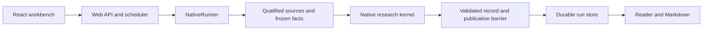

# TradingAgents Architecture

Status: Current

## Goal and reading path

TradingAgents is a local China A-share company-research workbench. It should make a judgement's
supporting evidence, counterevidence and unresolved questions inspectable. It produces research,
not orders or target positions. Start with [README](README.md); use this page to locate a change,
[Web operations](docs/operations/evidence-research.md) to use the product, and
[CONTRIBUTING](CONTRIBUTING.md) to develop it.

## Consumers And Entry Flow

`tradingagents web --port 8765 --open` starts one loopback FastAPI service and its bundled React SPA.
The Web adapter creates and schedules runs, streams saved events, and projects saved artifacts.
Execution and domain models remain independent of HTTP/UI concerns.

## Native Research Architecture

New single and batch studies use `evidence_v1` / `evidence-production-v8`, kernel
`native-research-kernel-v7`, and `research-record-v2`. New creation supports `company_research` only.
The workflow name, kernel name and public record name are separate versioned contracts.

1. Dedicated APIs collect identity, company information, financials, prices and valuation.
   DeepSeek/Tavily search adds dated context and attempts narrowly requested missing fields.
2. Code qualifies sources and freezes facts. Operating, event and market specialists receive
   isolated views; they cannot read each other's drafts. Accepted outputs merge in fixed order.
3. One challenge stage identifies counterevidence and testable propositions. Code performs bounded
   checks on qualified saved inputs, then each challenged specialist may reply once.
4. Up to three shared supplementary-search rounds can add qualified material and review affected
   judgements. Original facts, hypotheses and receipts remain traceable to their snapshots.
5. Synthesis combines the effective findings into four dimensions, referenced reasons and change
   conditions. Section validation and one targeted repair preserve independently valid analysis.
6. The executor freezes the baseline, optionally answers the user's focus from saved evidence,
   then publishes the mandatory baseline and any qualified supplement. Markdown uses the same record.

Code owns qualification, calculations, reference validation, budgets and publication; models propose
interpretations. Context isolation is not statistical independence. Numeric/reference checks do not
prove free-prose entailment, economic causality, fair value or predictive accuracy.

New Web studies resolve an omitted cutoff to the current Asia/Shanghai date; historical requests and
resume retain their saved date. Fresh numeric V8 calls freeze `research_delivery_policy=evidence-packets-v1`
(with its exact policy payload). [evidence_packets.py](tradingagents/research/evidence_packets.py)
renders all role-qualified observations as sourced Markdown cards and ranks bounded passages from
their saved source bodies by lexical overlap. Models select short card citations; the host derives
canonical observation/fact references. This is local retrieval, without an embedding service or new
evidence admission. The pure adapter
[inline_bindings.py](tradingagents/research/inline_bindings.py) derives binding paths from the
response structure and restores the canonical numeric envelope before existing admission checks.
Per-hypothesis challenge-review receipts bind the accepted challenge proposal and exact numeric
context; the Reader replays them. The policy also reserves a repair opportunity for each basic stage.
Saved proofs/public records retain their formats; old runs retain their original prompts and budgets.

## Publication And Projections

### Shared Projections And Native Publication

A saved stage proposal and a published report have different qualification gates. The Reader can
show validated intermediate outputs without presenting them as final conclusions. Final native
publication requires an assessed versioned record, matching frozen input and a durable authorization
barrier. Cancellation and publication authorization are arbitrated under the same lifecycle lock.

Publication failure cannot become `run.completed` or silently fall back to a legacy case. Partial
synthesis retains usable evidence; missing overall judgement or critical adjudication suppresses the
rating. `completed`, readable, evidence-complete and research-quality are distinct states.

Reader, stage, focus and export projections read qualified saved content; they do not fetch new
research or dispatch models. Missing or corrupt bindings remain unavailable. API/DTO ownership,
financial and numeric rules, search budgets and snapshot semantics are in the
[research contract](docs/contracts/research-record.md).

### Plain-language reading supplement

Eligible new studies can run a separate post-completion explanation job using the frozen quick-model
configuration. It owns its manifest/artifact and does not change the baseline, ratings or research
budgets. Fresh-policy jobs process bounded batches, save accepted entries after each response, and
expose explained/pending/unavailable counts. Reading is a GET; explicit explanation generation/retry is a POST. Historical reads never
acquire this job automatically. See [reading semantics](docs/contracts/research-record.md#reader-focus-and-explanations).

## Module Ownership And Extension Points

| Change | Owner and first source | What must stay true |
| --- | --- | --- |
| Request, run orchestration and model dispatch | [execution](tradingagents/execution/), `models.py`, `native_runner.py`, `native_model.py` | Freeze configuration and identity before collection; preserve attempt accounting. |
| Research sequence and isolated role inputs | [graph/native_research.py](tradingagents/graph/native_research.py), [native policy](tradingagents/research/native_policy.py) | Fixed merge order; explicit scopes, replies and current applicability. |
| Public record, hypothesis and assessment | [agents/schemas](tradingagents/agents/schemas/), [research](tradingagents/research/) | Start at canonical models; update producers, replay, publication and projections together. |
| Provider or source qualification | [dataflows](tradingagents/dataflows/) | Typed source-labelled results; preserve cutoff, units, periods and coverage. |
| Events, checkpoints and reports | [runtime](tradingagents/runtime/), [observability](tradingagents/observability/) | Durable attempt state, batch contracts, publication barriers and saved-history compatibility. |
| HTTP, SSE and Reader/Audit projection | [web](tradingagents/web/) | Closed DTOs from qualified artifacts, with explicit missing/unsupported states. |
| Browser transport, state and presentation | [frontend/src](frontend/src/), `api/contracts.ts` | Preserve run/sequence identity; rebuild the tracked SPA after source changes. |

Dependency direction is adapters → execution/runtime → graph/research/dataflows/domain schemas.
Do not introduce Web/HTTP types into domain execution. Provider implementations belong in dataflows;
projections do not become canonical domain schemas. Methodology role mapping belongs to
[skills/registry.py](tradingagents/skills/registry.py); the bundled Markdown library currently serves
statically mapped classic roles, not the native specialists.

## Persistence

| Data | Default location |
| --- | --- |
| Durable Web runs, append-only events, artifacts and reports | `~/.tradingagents/web/runs/` |
| Cache and classic checkpoints | `~/.tradingagents/cache/` |
| Non-Web reports/logs | `~/.tradingagents/logs/` |
| Web server log | `~/.tradingagents/web/logs/server.log` |
| ChatGPT registrations | `~/.tradingagents/auth/chatgpt/registrations.json` |

Run directories are user records. Do not clear or rewrite them during routine development.
A single store owner is required. The supported Web launcher holds a cross-process owner lock
before recovery until shutdown; directly constructed store instances do not share a writer lock.
Resume reuses saved versions, qualified inputs and spent budgets. Dispatched attempts with unknown
outcomes stay consumed and are not automatically replayed. Recovery and diagnostics are described in
[observability](docs/operations/observability-replay.md).

## Legacy Workflow And Research Routing

`TradingAgentsGraph → AnalysisRunner → LangGraph` remains a public classic compatibility path;
CLI analysis is outside continued maintenance. Historical native and catalyst runs preserve their
saved identity for reading/recovery. Retired classic/catalyst profile creation returns 410; new
native catalyst/holding mode creation returns 422. Neither old profiles nor old modes are silently
upgraded to current research.

### Legacy Catalyst Publication

The retained catalyst executor publishes its case and additive record under its original budget and
publication rules. Classic publishes case/package artifacts. These are compatibility surfaces,
not alternative new Web workflows. See [legacy reference](docs/operations/catalyst-research.md).

## Runtime Policy

Classic production runtime selects `horizon-policy-v2` in
[runtime/contracts.py](tradingagents/runtime/contracts.py); v3 is an internal test gate.
Native research has its own evidence/workflow identity. Optional classic checkpoint settings do not
disable durable native/catalyst attempt and publication state.

## Current development priorities

Preserve the evidence/publication boundaries while improving source coverage, dependable recovery and
reader comprehension. Fixed-input comparisons, real-model quality/cost evaluation and human reading
acceptance remain separate from passing schema or fixture tests. The
[2026-10-25 review](docs/reviews/2026-10-25-documentation-code-audit.md) records the audit and scoped
recovery, history, configuration and measurement fixes. Further architecture work should clarify
version-policy ownership and graph/execution interfaces without deleting historical compatibility.
Historical implementation discussions remain accessible through the [archive](docs/archive/README.md).
