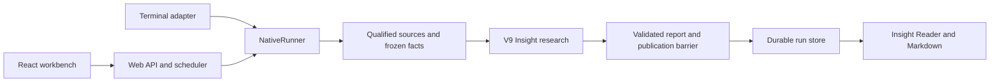

# TradingAgents Architecture

Status: Current

TradingAgents is an A-share company-research application with CLI and loopback Web adapters. Both execute `evidence_v1` / `evidence-production-v9` and publish `insight-research-v1`. Its outputs are inspectable research, not orders or target positions. Classic multi/bear debate, catalyst execution and V1–V8 adapters are retired. Existing user files remain untouched; no automatic conversion is performed.

## Entry and execution

`tradingagents web --port 8765 --open` starts FastAPI and the bundled React SPA. `tradingagents analyze --ticker 002130` runs synchronously in the terminal. Adapters construct the same `AnalysisRequest` and invoke `NativeRunner`; execution stays independent of HTTP and terminal presentation.

Dedicated interfaces collect company and quantitative data; DeepSeek/Tavily add qualified context. Specialists may also request bounded structured supplements from a short capability catalog (official disclosures, shareholder counts, IR Q&A, consensus samples, market records); the host routes a-stock-data-aligned adapters, qualifies results and reopens only affected specialties. Operating, event and market specialists independently propose four-field Insights. Code resolves references, renders exact numbers, saves valid siblings, and bounds supplementary search plus capability calls. One critique/reply round precedes synthesis, which uses saved effective Insights. Missing overall support suppresses the rating without discarding usable research. Optional focus follows the baseline and cannot change it.

## Owners and boundaries

| Responsibility | Owner |
| --- | --- |
| Consumer-neutral request, execution and model dispatch | `execution/models.py`, `native_runner.py`, `insight_model.py` |
| V9 sequence, review, response, web/capability supplements and synthesis | `graph/insight_research.py`, `execution/insight_search.py`, `execution/insight_capability.py`, `execution/capability_gateway.py`, `research/insights.py` |
| Public Insight report and reference/numeric validation | `agents/schemas/_insight.py`, `research/insight_report.py` |
| Source retrieval, model-facing capability catalog, qualification and calculations | `dataflows/` (including `capability_catalog.py`), `research/` |
| Append-only attempts, budgets, events and report publication | `runtime/`, `execution/budget.py`, `native_publication.py` |
| HTTP, scheduling and saved projections | `web/` |
| Terminal configuration, lifecycle and presentation | `cli/config.py`, `cli/research.py`, `cli/main.py` |
| Browser transport and presentation | `frontend/src/api/`, `state/`, `hooks/`, `components/` |

Dependency direction is adapters → execution/runtime → graph/research/dataflows/domain schemas. Provider I/O stays outside the graph. Source and numeric evidence structures that V9 needs remain current infrastructure; their schema version numbers do not select an older workflow.

## Persistence and publication

Web stores run data under `~/.tradingagents/web/runs/`; CLI uses `~/.tradingagents/cli/runs/`. Each adapter holds its store's cross-process writer lock. User data is never cleared during development.

Request identity and budgets freeze before dispatch. Resume checks current V9 identity and replays saved valid results; unknown provider outcomes remain spent. A frozen report candidate and durable lifecycle authorization must precede committed publication. Cancellation and publication are serialized by the owning lifecycle lock. A publication failure cannot become completion.

Reader, stage views and Markdown expose saved qualified content. Reading never fetches new research or dispatches a model. Web schedules independent bounded explanation jobs after report completion; explicit retry uses a separate command. Their artifacts preserve baseline evidence and judgement. Completed, readable, evidence-complete and research-quality remain separate states; passing structural checks does not establish economic correctness.

Use [Web operations](docs/operations/evidence-research.md), [CLI operations](docs/operations/cli-research.md), [research contracts](docs/contracts/research-record.md) and [contributor guidance](CONTRIBUTING.md) for the owning details. Dated archived plans describe their writing-time state, not current support.

