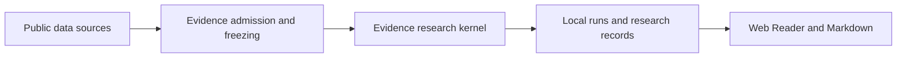

[简体中文](README.md) | English

# TradingAgents

A local multi-agent research workbench for China A-shares, derived from [TauricResearch/TradingAgents](https://github.com/TauricResearch/TradingAgents). It turns company profiles, disclosures, financials and prices into reviewable research records, helping researchers identify **key evidence, the main doubts and what to verify next**.

New studies use one company investment research workflow, combining operations, current valuation, events and market risk into a stance, reasons, counterevidence and change conditions. Batch company research is supported; historical catalyst and holding records remain readable and resumable. The Web workbench is the maintained entry. It does not generate orders or target positions, or provide investment advice.

[](https://david188888.github.io/videos/tradingagents-demo-20261008.mp4)

24-second demo with English narration and captions, showing a saved historical research sample (2026-10-06) in the historical Reader. Click the poster to play.

## Project highlights

- **A-share evidence chain**: combines public company information, official disclosures, financials and prices while preserving sources, timestamps and coverage limits.
- **Purposeful Agent roles**: operating, event and market specialists develop isolated hypotheses followed by one challenge round, actual checks, targeted specialist replies and synthesis; important challenges record verifiability and task outcomes for independently proposed tests. Code owns evidence admission, reference validation and deterministic calculations.
- **Dual web evidence collection**: DeepSeek and Tavily discover news, industry, policy and competitor material. Dedicated APIs remain first for identity and quantitative data, with field-specific search fallback. Qualified new evidence can trigger bounded supplementary research and review of affected judgments. See the [dual-search contract](docs/contracts/dual-search-research.md).
- **Traceable research reading**: inspect qualified saved stage outputs, facts and sources while research is running, with stage proposals clearly separated from final conclusions. Reader and Markdown share the same saved record; reading does not fetch data or invoke models.
- **Company report delivery**: preserve public introductions, fundamentals and market observations independently. Validate synthesis by section, repair failed sections and retain valid analysis. An unfinished overall judgement or critical challenge adjudication suppresses the rating; synthesis execution failures remain distinct from financial data gaps.
- **Verifiable numeric fragments**: new studies reference frozen numbers that code renders with units, periods and actual/forecast labels, validated through Reader and export. Qualified structured financial comparisons are checked independently, with full cash-bridge gaps kept separate. New studies separately preserve and display observations, interpretations and pending premises. Surrounding explanations still need researcher review; see the [numeric contract](docs/contracts/numeric-narrative.md).
- **Plain-language reading**: financial and historical-risk indicators include definitions and readable numbers. New studies receive a separately saved model explanation shared by the report and related evidence, with professional wording available to expand. Historical reports receive indicator and formatting improvements only. See the [reading boundaries](docs/contracts/report-explanation.md).

## Overall architecture and Agent design



| Role / layer | Responsibility |
| --- | --- |
| Operating, event and market specialist Agents | Propose hypotheses and invalidation conditions from their own evidence views, without reading other specialists' drafts. |
| Independent challenge Agent | Identify counterevidence, evidence gaps and conditions to check. |
| Challenged specialist Agents | Reply once from bounded saved facts, maintaining, revising, withdrawing or admitting they cannot answer. |
| Synthesis Agent | Combine evidence, counterevidence and replies into an investment stance, reasons, falsifiers and four-dimensional judgments. |
| Code host | Control source admission and execution boundaries, check computable conditions, validate and persist results. |

Baseline research completes independently and is saved before an optional response to the user's focus; that response cannot rewrite baseline conclusions. Execution, recovery and module boundaries are detailed in the [architecture](ARCHITECTURE.md).

## Quick start

Requires Python 3.10+. Use an API key for your chosen model provider, or authorize ChatGPT subscription usage through official sign-in. The default model is DeepSeek V4.1 Flash (`deepseek-flash`).

```bash
git clone https://github.com/david188888/TradingAgents.git
cd TradingAgents
# Reuse the existing tradingagents Conda environment.
# Only if it does not exist yet: conda create -n tradingagents python=3.13
conda activate tradingagents
python -m pip install -e ".[china,web]" --index-url https://pypi.org/simple

cp .env.example .env
# Set DEEPSEEK_API_KEY in .env; configure TAVILY_API_KEY for dual search.
# The research model can also use ChatGPT subscription sign-in after startup.

tradingagents web --port 8765 --open
```

The install command explicitly uses official PyPI to avoid mirror access failures. The default A-share installation excludes mootdx because its dependencies conflict with Web; see [A-share data capabilities](docs/operations/a-share-data-capabilities.md) for existing-environment repair and TDX supplements.

After subscription sign-in, model choices follow the account’s official catalog; permissions and limits are confirmed by the official service. See [ChatGPT subscription configuration](docs/operations/chatgpt-subscription.md).
Fresh ChatGPT studies support explicit reasoning-effort configuration while historical recovery preserves its original request semantics; token refresh uses per-account backoff for transient failures.

Web binds only to `127.0.0.1`, includes its frontend and needs no Node.js at runtime. Run records live under `~/.tradingagents/`. Keep credentials in ignored local configuration. Data entitlements and configuration are described in [.env.example](.env.example) and [Web operations](docs/operations/evidence-research.md).

## Current limitations

- **Limited coverage**: public sources may be missing, rate-limited or unable to establish historical availability. Some historical valuation capabilities require Tushare credentials and entitlements. The trading calendar is now derived locally from index bars and no longer depends on a daily-quota vendor.
- **Research quality needs evaluation**: completed runs may remain `partial / LOW_CONFIDENCE`. Passing evidence checks does not establish economic causes or fair value, and improved predictive accuracy has not been demonstrated.
- **Defined product scope**: maintained research runs through the local A-share Web workbench. CLI analysis is no longer maintained; older workflows retain saved reading and compatible recovery.

## Explore further

| Question | Documentation entry |
| --- | --- |
| Architecture, module ownership and Agent boundaries | [ARCHITECTURE.md](ARCHITECTURE.md) |
| Operations, sources, models and recovery | [Web operations](docs/operations/evidence-research.md) · [Model configuration](docs/operations/llm-reasoning.md) |
| Research records and evidence contracts | [Contract index](docs/contracts/README.md) · [Research record](docs/contracts/research-record.md) |
| Reader evidence tracing and presentation | [Reader architecture](docs/architecture/research-reader.md) |
| Coding Agent and contributor workflow | [AGENTS.md](AGENTS.md) · [CONTRIBUTING.md](CONTRIBUTING.md) |
| All documentation and release records | [Documentation index](docs/README.md) · [3.7.0 release notes](docs/reviews/2026-10-24-v3.7.0-release-notes.md) |

Coding Agents should start with [AGENTS.md](AGENTS.md). Code, contracts and current-state docs define supported behavior; historical plans are not implementation evidence.


## Acknowledgments and license

Thanks to [TauricResearch](https://github.com/TauricResearch/TradingAgents) for the multi-agent foundation, [Simon Lin](https://github.com/simonlin1212/a-stock-data) for the A-share data reference, and the data-service and open-source maintainers. This fork develops the evidence research and local workbench design described above on that foundation. See [LICENSE](LICENSE).
