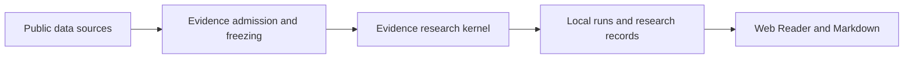

[简体中文](README.md) | English

# TradingAgents

A local multi-agent research workbench for China A-shares, derived from [TauricResearch/TradingAgents](https://github.com/TauricResearch/TradingAgents). It turns company profiles, disclosures, financials and prices into reviewable research records, helping researchers identify **key evidence, the main doubts and what to verify next**.

New studies use one company investment research workflow, combining operations, current valuation, events and market risk into a stance, reasons, counterevidence and change conditions. Web supports batch company research; CLI and Web share the V9 Insight runner. The system does not generate orders or target positions, or provide investment advice.

[](https://david188888.github.io/videos/tradingagents-demo-20261008.mp4)

24-second demo with English narration and captions, showing a saved historical research sample (2026-10-06) in the historical Reader. Click the poster to play.

## Project highlights

- **A-share evidence chain**: combines public company information, official disclosures, financials and prices while preserving sources, timestamps and coverage limits.
- **Purposeful Agent roles**: isolated operating, event and market specialists produce Insights containing a claim, evidence references, reasoning and limitations. One critique/reply round informs synthesis. Specialists, challenge and synthesis can each use a different provider and model to avoid a single-model perspective; code owns numbers, references and effective versions.
- **Current information and evidence citations**: new studies use currently available information. Models select short evidence references and numeric tokens; code resolves saved sources and passages. No effective counterevidence, missing review and failed review remain distinct.
- **Dual web evidence collection**: DeepSeek and Tavily discover news, industry, policy and competitor material. Dedicated APIs remain first for identity and quantitative data, with field-specific search fallback. Qualified new evidence can trigger bounded supplementary research and review of affected judgments. See the [dual-search contract](docs/contracts/dual-search-research.md).
- **Traceable research reading**: inspect qualified saved stage outputs, facts and sources while research is running, with stage proposals clearly separated from final conclusions. Reader and Markdown share the same saved record; reading does not fetch data or invoke models.
- **Company report delivery**: preserve basic facts and valid Insights independently. Repair invalid items once without discarding valid siblings. Invalid synthesis support suppresses the overall rating; missing a prescribed valuation anchor no longer overrides the synthesis Agent, and gaps remain explicit.
- **Verifiable numeric fragments**: code calculates and renders values with subject, units, period and provenance. Unbound quantities cannot pass admission; valid references and arithmetic do not prove economic reasoning. See the [research contract](docs/contracts/research-record.md#insight-first-v9).
- **Plain-language reading**: Web generates and saves independent explanations after report completion; missing explanations retain original text. Explanation coverage is not a research acceptance gate, and reading itself does not trigger generation. See the [reading boundaries](docs/contracts/report-explanation.md).

## Overall architecture and Agent design



| Role / layer | Responsibility |
| --- | --- |
| Operating, event and market specialist Agents | Produce four-field Insights from their own evidence views, without reading other specialists' drafts. |
| Independent challenge Agent | Question judgements, evidence sufficiency and alternative explanations; record when no effective counterevidence was found. |
| Challenged specialist Agents | Reply once from bounded saved facts, maintaining, revising, withdrawing or admitting they cannot answer. |
| Synthesis Agent | Combine evidence, counterevidence and replies to judge evidential sufficiency, overall stance and limitations. |
| Code host | Control source admission and execution boundaries, compute numbers, resolve references, and preserve valid versions. |

Baseline research completes independently and is saved before an optional response to the user's focus; that response cannot rewrite baseline conclusions. Execution, recovery and module boundaries are detailed in the [architecture](ARCHITECTURE.md).

## Quick start

Requires Python 3.10+. Use an API key for your chosen model provider, or authorize ChatGPT subscription usage through official sign-in. The default model is DeepSeek V4.1 Flash (`deepseek-flash`).

```bash
git clone https://github.com/david188888/TradingAgents.git
cd TradingAgents
# Reuse the existing tradingagents Conda environment.
# Only if it does not exist yet: conda create -n tradingagents python=3.13
conda activate tradingagents
python -m pip install -e ".[china,web]" --index-url https://pypi.org/simple

cp .env.example .env
# Set DEEPSEEK_API_KEY in .env; configure TAVILY_API_KEY for dual search.
# The research model can also use ChatGPT subscription sign-in after startup.

tradingagents web --port 8765 --open
```

The install command explicitly uses official PyPI to avoid mirror access failures. V9 checks the trading calendar against TDX daily packages without the mootdx SDK. See [A-share data capabilities](docs/operations/a-share-data-capabilities.md) for existing-environment repair.

After subscription sign-in, model choices follow the account’s official catalog; permissions and limits are confirmed by the official service. See [ChatGPT subscription configuration](docs/operations/chatgpt-subscription.md).
Fresh ChatGPT studies support explicit reasoning-effort configuration while historical recovery preserves its original request semantics; token refresh uses per-account backoff for transient failures.

Web binds only to `127.0.0.1`, includes its frontend and needs no Node.js at runtime. Run records live under `~/.tradingagents/`. Keep credentials in ignored local configuration. Data entitlements and configuration are described in [.env.example](.env.example) and [Web operations](docs/operations/evidence-research.md).

## Terminal research

```bash
tradingagents analyze --ticker 002130 --show
tradingagents analyze --resume RUN_ID
```

The terminal uses the same V9 runner as Web, with a separately owned store at `~/.tradingagents/cli/runs/`. Use `--config` for local JSON, `--focus` for a follow-up question, and `--output report.md` for Markdown export. V9 always saves durable progress; debate-round and transaction-stage choices are removed. See [CLI operations](docs/operations/cli-research.md).

## Current limitations

- **Limited coverage**: public sources may be missing, rate-limited or unable to establish historical availability. Some historical valuation capabilities require Tushare credentials and entitlements. The trading calendar prioritizes the official SZSE month grid with index-date/TDX witnesses; Tushare is the last fallback.
- **Research quality needs evaluation**: completed runs may remain partial or unrated. Passing evidence checks does not establish economic causes or fair value, and improved predictive accuracy has not been demonstrated.
- **Current scope**: CLI and Web share V9 Insight A-share company research. Classic, catalyst and V1–V8 execution, reading and recovery are retired. Existing user data stays on disk without automatic conversion.

## Explore further

| Question | Documentation entry |
| --- | --- |
| Current goals, workflow, module ownership and extension points | [Architecture](ARCHITECTURE.md) |
| Creation, reading, model configuration and recovery | [Web operations](docs/operations/evidence-research.md) |
| Development setup, change routing and validation | [Contributing](CONTRIBUTING.md); Coding Agents also read [AGENTS.md](AGENTS.md) |
| Optional technical references and historical context | [Documentation index](docs/README.md) |

Coding Agents should start with [AGENTS.md](AGENTS.md). Code, contracts and current-state docs define supported behavior; historical plans are not implementation evidence.


## Acknowledgments and license

Thanks to [TauricResearch](https://github.com/TauricResearch/TradingAgents) for the multi-agent foundation, [Simon Lin](https://github.com/simonlin1212/a-stock-data) for the A-share data reference, and the data-service and open-source maintainers. This fork develops the evidence research and local workbench design described above on that foundation. See [LICENSE](LICENSE).
