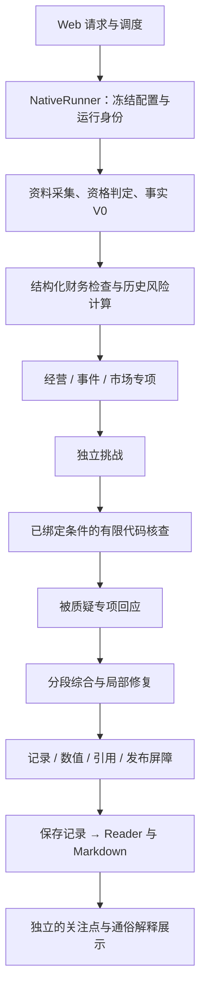

# TradingAgents 架构、研究流程与结论有效性检测报告

Status: Historical

**Do not use this document as evidence of current implementation behavior.**

审查日期：2026-10-20，Asia/Shanghai。审查对象由用户确认为**当前工作区，包含全部未提交改动**。
基线提交为 `e8c283de8734a1bdbc6aa67158eb58f9702524c3`，不是仅审查该提交。
当前合同入口：[架构](../../ARCHITECTURE.md)、[公司研究](../contracts/unified-company-research.md)、
[数值叙述](../contracts/numeric-narrative.md)、[财务检查](../contracts/structured-financial-checks.md)。
本报告是上述日期的检测快照，建议尚未实施。

## 主要结论

**系统已具备较完整的证据保存、结构校验和故障恢复基础，但尚不能据此认定研究结论可靠性已经达标。**
最需要优先处理的是数据准入的日历错误，以及“引用合法”与“整句判断有依据”之间的缺口。
继续增加 Agent、放宽数值校验或直接增加重试次数，都没有足够证据支持。

本次确认：

- **数据准入存在可复现缺陷**：日历检查拒绝周末和当日开盘前的正常尾部，同时把窗口内部缺失日期直接解释为休市。
- **保存报告存在引用不能完整支撑观点的实例**：江淮汽车的一个有效专项假设写了“销售费用增加”，其四条支撑事实及对应数字行均未提供销售费用。它通过了当前记录和数值验证。
- **定向核查在观察样本中没有实际运转**：最新两份报告共八条假设，已接受条件的可执行 `check` 全部为空；固定五项检查确实存在，但不能代替假设导向核查。
- **成本和存储存在放大**：两份报告研究输入累计约 53.7 万、87.3 万 tokens；检查点累计约 228 MB、273 MB。
- **工程保护机制值得保留**：部分综合交付、冻结输入重建、数值证明重放、取消与发布屏障、历史兼容，在本次定向验证中没有发现需要推倒重建的证据。

这里的“结论有效性”指事实支持、推理边界、反证处理和可复核性，不指未来股价收益。本次没有进行新的付费模型实验、预测回测或证券价值判断。

## 第一性原理：用什么标准审查

系统要回答的核心问题是：截至给定时点，这家公司的投资吸引力如何，依据是什么，什么反证会改变判断。
完成这一目标至少需要以下不变量。

| 不变量 | 失败条件 | 本次判断 |
| --- | --- | --- |
| 输入确实属于该公司、该时点、该口径 | 错公司、错期次、错单位，或将供应商缺数当成客观事实 | 财务检查较严格；日历完整性判断存在缺陷 |
| 重要判断的每个事实前提都能追溯 | 引用存在，但没有支持所说的事实或变化方向 | 存在实际反例 |
| 每个研究阶段提供不同的信息价值 | 反复重述缺口，未形成可执行检验或改变判断 | 分工清楚；边际价值缺少对照验收 |
| 核查结果只回答它实际检查的问题 | 算术正确被扩大为因果、持续性或估值正确 | 合同与代码主动限制扩大解释，方向正确 |
| 交付状态与判断质量分离 | `completed`、`synthesized` 或 `PASS` 被理解为投资判断正确 | 多轴状态已存在，仍须保持清晰解释 |
| 中断、重连、恢复不能产生隐性重复决策 | 未知派发自动重跑、取消后发布、读取触发模型 | 定向测试支持现有保护机制 |
| 成本有界且与新增信息相称 | 调用次数有界，但单次上下文和持久化体积持续放大 | 次数预算有效，信息与存储效率待改善 |

## 审查范围、证据与限制

采用代码阅读、负向离线输入、现有定向测试和真实保存记录复核四类证据。审查覆盖维护中的 Web 原生链路；旧 LangGraph 主要检查兼容边界，没有逐行审查所有旧节点。

开始时对 Git 管理及非忽略未跟踪文件建立了 **956 个路径的 SHA-256 清单**。检测结束、添加本报告前，比对未发现基线文件变化。全部现有未提交实现均作为审查对象；未修改产品代码、历史运行、配置或模型策略。

机器证据见 [检测数据](2026-10-20-architecture-workflow-review-evidence.json)，包含代码指纹、日历复现程序与结果、保存报告摘要、12 份 V7 运行计量、两份输入重建哈希及验证边界。
其中只摘录与问题有关的公开事实和诊断，不包含账户凭据、完整提示词或完整模型响应。

本次读取的历史 Hindsight 提示和本地记忆仅用于定位证据分层、发布与恢复边界；以下结论均重新核对当前代码或本次输出。未追加 Hindsight 查询或写入。

### 当前实际链路



图中关注点回应的计算由内核之后的执行层完成，其产物在基础记录发布后独立发布；通俗解释是完成后的补充任务。两者都不应改写基础判断。
主流程由 [native_runner.py](../../tradingagents/execution/native_runner.py) 和
[native_research.py](../../tradingagents/graph/native_research.py) 实现；不是旧 `TradingAgentsGraph` 的主执行路线。

## 按优先级排序的发现

优先级含义：P1 为优先修复的正确性问题；P2 为影响有效性、成本或可诊断性的改进项；P3 为维护性事项。
“代码缺陷”“报告缺陷”“架构风险”“验收缺口”分别标注，避免把设计取舍都归为 bug。

### F01 · P1 · 代码缺陷：日历完整性与交易日语义混淆

**位置：** [native_qualification.py](../../tradingagents/dataflows/native_qualification.py)，`qualify_session_calendar`，第 199–237 行；
[native_sources.py](../../tradingagents/dataflows/native_sources.py)，`_calendar`，第 254–281 行。

当前代码要求 `max(sessions) >= cutoff`。但周末没有对应日 K，当日开盘前也不存在当天完整日 K。
这不是供应商缺失已完成行情。正常输入因此被判为 `calendar_window_not_complete`。

本次直接调用当前函数复现：

| 离线输入 | 当前结果 | 应区分的语义 |
| --- | --- | --- |
| 已有 10 月 15、16 日 K，截止日为 10 月 18 日周日 | 拒绝 | 已完成交易日可用；自然日尾部不是缺交易日 |
| 同上，截止日为 10 月 19 日，采集时间为周一 00:08 | 拒绝 | 当天尚未开始交易，不能要求当天日 K |
| 仅有 10 月 15、19 日 K，窗口中间缺 16 日 | 接受，并将 16 日标为休市 | 来源漏日与实际休市无法仅凭缺 K 区分 |

最后一项是另一方向的完整性漏洞：代码只检查两端，随后把所有不在 `sessions` 的日期标为关闭。
若原始股票行情包含缺失的那一天，后续通常会拒绝价格序列；若两个输入同时漏日，则存在错误接受不完整样本的风险。本次未声称真实样本已发生后一种情况。

**真实关联证据：** 两份最新记录都保存了腾讯日历 `calendar_window_not_complete`。宁德时代通过 Tushare 日历回退取得行情；江淮汽车另遇深交所不支持该交易所、Tushare 限流，最终行情及当前估值不可用。离线复现证明代码路径有问题；没有保存完整失败响应，因此不把历史错误码单独认定为全部根因。

**建议：** 分开“观察截止日”“最后已结算交易日”“供应商覆盖完整性”。缺日必须能由可靠日历或覆盖证据解释；不能仅删除尾部检查，也不能直接把所有缺 K 日期认定为休市。

**验收：** 周末、长假、交易日前后、历史窗口、窗口内部漏日、重复日期均有正负测试；在冻结失败输入上恢复有限行情能力，同时继续拒绝无法证明完整性的序列。

### F02 · P1 · 报告缺陷：合法引用没有覆盖整句事实前提

**位置：** [schema 引用检查](../../tradingagents/agents/schemas/_native_stage.py)，`validate_hypothesis_references`，第 135–141 行；
[数值叙述](../../tradingagents/research/numeric_narrative.py)，模块边界说明及数值编译；
[最终支撑检查](../../tradingagents/research/unified_assessment.py)，`validate_unified_assessment`。

江淮汽车保存运行 `run_20261018T161117240227Z_021254c5` 的假设
`h.34f8213d6e10774fd8c6bb7ed5f0e82ca2b2a062550369548eb7c548b536c880` 写道：

> 收入扩张与亏损并存，且销售费用增加可能抵消部分规模收益；需进一步检验费用增长是否伴随可持续的销量、产品结构或盈利改善。

其支撑事实只有：

| Fact ID | 实际保存内容 |
| --- | --- |
| `f.a258f3629b77240c8e460abc00c88bd5` | 营业收入本期与上年同期 |
| `f.675e4e22cca88c3779f19504542ddbea` | 归母净利润本期与上年同期 |
| `f.9615b28f0de2631a7cb9eaa1512920e8` | 合并净利润本期与上年同期 |
| `f.f67bd1bcad20b31f4d06886950fc806d` | 经营现金流本期与上年同期 |

对应来源是这四种字段的独立数字行，而不是包含所有项目的完整报表。保存 fact 中也没有“销售费用”事实。
本次重新运行 `ResearchRecordV1` 和 `validate_record_numeric`，整份报告通过；该假设未被两条已保存挑战选中。

**影响：** 点击引用能够找到来源，但读者无法从绑定事实确认“销售费用增加”。“可能”限制的是其经济影响，不能代替费用确实增加的证据。
这不证明真实销售费用没有增加，也不证明最终中性立场错误；它证明系统当前的可追溯保证没有覆盖这一句已交付观点。
最终综合理由没有直接引用该条费用推断，因此不能将其影响夸大为“总体结论已被污染”。

**建议：** 将一句话中的观察前提与解释假设分开绑定，特别检查“上升、恶化、改善、主要贡献”等无数字的事实判断。
优先把能确定计算的方向性关系转成可复核比较；无法核对的前提明确降为待验证假设。不要试图仅靠正则识别数字来解决语义支持问题。

**验收：** 用本实例及同类负向样本检验“正确引用但无关内容”“部分句子有依据”“方向错误”三种情况；记录漏检和误拒，而不只记录 schema 通过率。

### F03 · P2 · 验收缺口：假设导向核查未在真实样本形成闭环

**位置：** [条件 schema](../../tradingagents/agents/schemas/_native_stage.py)，第 29–32 行；
[核查任务装配](../../tradingagents/graph/native_research.py)，第 342–382 行；
[验证执行器](../../tradingagents/execution/verification_executor.py)，`execute_verification`。

任务只有在挑战选择了条件、且该条件已经带有 `check` 时才进入执行器。可执行条件只有冻结财务字段比较和保存指标阈值，没有新增来源检索能力。

本次计量得到 12 份 V7 运行，其中 10 份有正式研究记录；这 10 份的 `executed_verification_count` 均为零。
最新两份报告共八条接受假设，所有条件 `check` 均为空。与此同时，两份都执行并保存了五项固定证据检查，不能称为“完全没有核查”。

**影响：** 系统能保存质疑、回应与建议下一步，但当前真实样本尚不能证明假设的可执行验证能力被有效使用，更不能把同一证据上的模型对话称为独立外部验证。
涉及未来持续性的条件本来就无法当场求证，零执行不自动代表某次运行错误。

**建议：** 对每个 material/critical 挑战标明“当前可算、当前需补来源、未来观察、无法检验”，并给出没有生成或执行任务的原因。先对确实可算的挑战度量任务生成覆盖率，再决定是否扩展工具。

**验收：** 使用预先标注的可执行与不可执行样本；报告分母、执行结果是否改变原判断，以及未执行原因。不要用“多生成几个 check”代替质量验收。

### F04 · P2 · 架构风险：上下文和修复投入偏大，综合缺少预算保障

**位置：** [专项及挑战上下文](../../tradingagents/graph/native_research.py)，第 240–280、335–351 行；
[回应上下文](../../tradingagents/research/unified_dialogue.py)，第 45–66 行；
[综合压缩](../../tradingagents/execution/native_prompt_context.py)，第 20–32 行；
[调用预算](../../tradingagents/execution/budget.py)，第 83–106 行。

综合阶段移除了原始证据正文和重复记录，但专项、挑战、回应仍可能同时携带来源正文、事实、数值目录及局部检查。
三个阶段并不天然需要相同粒度的原始内容。当前预算限制调用次数、并发和时间，不能直接约束累计输入 tokens。

| 实际保存用量 | 宁德时代 | 江淮汽车 |
| --- | ---: | ---: |
| 研究派发次数 | 7 | 7 |
| 结构修复次数 | 2 | 2 |
| 累计输入 tokens | 537,055 | 873,136 |
| 累计输出 tokens | 4,708 | 5,777 |
| 挑战单次输入 tokens | 162,304 | 174,935 |
| 综合单次输入 tokens | 101,102 | 109,778 |
| 通过／全部综合分段 | 6/6 | 7/8 |

江淮汽车的经营专项和经营回应已使用全局两个结构修复槽位，综合经营分段校验失败后，修复被 `budget_refused` 拒绝。总模型尝试数尚未达到 12；限制来自独立的修复预算。

**影响：** 局部修复可消耗大量重复上下文，并抢先耗尽关键综合阶段的修复机会。现有分段保留成功缓和了交付损失，但没有解决预算分配问题。

**建议：** 在相同冻结证据上先测量按任务压缩后的信息保留率，明确每阶段必需的证据片段，再比较预留综合修复槽位与现有共享预算。增加上限前应证明边际收益。

这里的 tokens 是保存的研究输入工作量，不等于收费金额；未按缓存命中或订阅计费折算。两份通俗解释各另有一次已派发、用量未知的失败请求，未包括在表中。

### F05 · P2 · 架构风险：全量检查点造成较大的持久化放大

**位置：** [catalyst_checkpoint.py](../../tradingagents/runtime/catalyst_checkpoint.py)，`persist/put`，第 101–125 行。

`put()` 每次调用 `persist()`，后者保存整个累积 `state`。状态包含 source/cache、seed、verification input/output、完整最终记录及发布候选等。
内容寻址可以复用完全相同的文件，却不能对仅改变一个状态字段的整个 JSON 做块级去重。

本次只读统计：

| 文件体积，十进制 MB | 宁德时代 | 江淮汽车 |
| --- | ---: | ---: |
| 正式研究记录 | 1.57 | 2.00 |
| 最新单份检查点 | 6.64 | 8.10 |
| 检查点文件数量 | 267 | 214 |
| 全部检查点累计 | 227.70 | 273.05 |
| 整个运行目录 | 229.71 | 275.44 |

**影响：** 大量批量研究会放大磁盘写入、空间占用、备份和恢复读取成本。这是已观察到的存储放大，不是已证实的数据损坏或延迟根因。

**建议：** 保留不可变证据和关键发布屏障，用内容哈希引用大型对象，把小型状态转移与大对象分开保存。存储压缩、保留与回收策略必须另行设计，不能为优化而直接清理历史用户记录。

**验收：** 同一冻结运行比较累计写入、峰值检查点、恢复耗时；在派发前后、结果保存前后、发布授权前后注入中断，证明恢复语义不变。

### F06 · P2 · 代码缺陷：通用 ValueError 被归为缺少配置

**位置：** [manager.py](../../tradingagents/web/manager.py)，`_error_category`，第 1752–1774 行。

代码已对 `NativeModelReferenceInvalid` 等类型单独分类，但剩余所有 `ValueError` 和 `KeyError` 都返回 `missing_configuration`。
数据解析、领域 schema 和数值目录错误也可能属于这些异常，用户会被引导去检查无关配置。

最近的失败运行 `run_20261018T160405191256Z_3149e2d5` 发生于模型前数值目录准备，历史记录保存的分类正是 `missing_configuration`。
相关数值长度问题已经在当前未提交代码中修复，本报告不重复报为未修复缺陷；仍存在的是通用分类逻辑。

**建议：** 仅显式配置异常归为配置问题，其余按数据资格、领域校验、持久化、模型传输或内部错误分类。保留安全 detail code，历史记录不重写。

**验收：** 同一入口分别注入配置缺失、无效来源字段、数值目录失败和发布错误，验证用户提示与恢复建议一致。

### F07 · P2 · 验收缺口：交付改善尚无足够证据证明判断质量改善

**位置：** [benchmark](../../scripts/eval_benchmark.py)，`measure_run/evaluate`；
[核查计量合同](../contracts/evidence-benchmark.md)。

当前指标能回答是否交付、分段是否完整、是否形成立场、派发及已计量用量是多少。人工假设质量、类型化挑战覆盖、派生指标覆盖仍为空。
按 workflow/provider/model 分组也没有区分同一 V7 中新增的数值策略、分段策略、财务检查策略，不能把组内历史成功率当作当前工作区成功率。

最新两次真实模型运行交付了综合，另一次同轮启动在模型前失败；样本只有两家公司。两份都是 `partial / LOW_CONFIDENCE / neutral`。
这证明有用分析可以交付，不能证明 neutral 的经济判断正确，也不能证明多 Agent 优于更简单的研究链路。

**建议：** 分两层验收：先固定证据、公司、模型与策略比较推理和质疑质量；再比较取数覆盖。
对每个核心结论检查事实前提、反证遗漏、方向性错误、可检验性和实际新增信息。重要性加权比单纯“引用事实占比”更适合作为质量指标。

**验收：** 预先固定样本与评分规则，记录所有失败启动、稀疏证据样本及无法评分项。若使用人工 rubric，需明确评分者；本次未生成主观评分或替换原计划评分者。

## 架构与稳定性综合判断

| 维度 | 有效机制 | 尚需解决的边界 |
| --- | --- | --- |
| 模块职责 | 采集、领域 schema、执行、持久化和投影分层清楚；模型不拥有最终发布权 | `runtime/store.py:20` 反向导入 `web.batch_models`，批次耐久模型宜归 runtime（P3） |
| 研究流程 | 专项看不到其他专项草稿；固定合并顺序；挑战和回应有界 | 上下文隔离不等于证据或模型错误独立；尚无角色消融证明每个阶段的收益 |
| 数据处理 | 公司身份、公告日、累计合并口径、同供应商同期比较、非正基期限制、Decimal 运算 | 日历资格存在缺陷；保守拒绝只能证明边界清晰，不能证明覆盖足够 |
| 数值与结论 | 数值来源、期次、单位、计算及公开片段可重放；修改或撤回推断退出正面支撑 | 文字方向、缺失事实前提、因果解释与价值判断仍不由数值校验保证 |
| 局部失败 | 分段独立保留；总体或 critical 裁决未完成时不评级；其余未完成标 partial | 非关键分段缺失仍保留立场是现有明确设计；本次未擅自建议改成全部不评级 |
| 发布与恢复 | 发布屏障、输入身份、未知派发保守处理、保存结果重用、SSE 重放 | 单进程锁不是多进程写入保证；未进行多进程共享目录或磁盘故障压力测试 |
| Reader / 导出 | 同一保存记录；专业文本与解释分离；未完成段落有显式标识 | 两份真实样本通俗解释均失败；当前证据不足以确定其根因 |
| 工程治理 | 本地测试、类型检查、构建与文档检查可执行 | 本地未见 `.github/workflows` 定义；本次未查远端保护、必需检查或外部 CI，不声称远端 CI 已通过 |

### 为什么保留现有关键保护

1. **事实冻结与输入哈希：** 两份最新报告在当前内核中离线重建，综合输入哈希与原保存值逐字节意义上的规范化哈希一致，没有重新调用模型。
2. **数值与财务口径：** 两份记录通过当前 canonical schema 和数值证明校验。新增结构化端点比较没有被冒充为完整现金流桥，经济母问题仍保留未解决状态。
3. **发布屏障：** `native_publication.py` 要求候选、授权哈希、提交事件及父检查点一致；运行取消和授权在生命周期边界裁决。
4. **有限失败交付：** 真实江淮汽车记录保留 7/8 分段，经营段明确未完成；没有因为缺一段而把全部事实与其余分析抹掉。
5. **恢复与重连：** 定向恢复、生命周期、检查点和 SSE 测试通过。支持这些受测场景，不能扩张成任何故障下都无重复或无损。

## 验证结果

全部使用既有 `/Users/david/miniconda3/envs/tradingagents` 环境及现有前端依赖。

| 验证 | 本次结果 | 证明范围 |
| --- | --- | --- |
| 内核、发布、隔离、有限核查、新财务检查、分段综合、benchmark、HTTP 发布专项 | 186 passed | 受测业务与负向合同 |
| 数据源、重试、记录、估值、关注点、预算、Store、Broker、生产接线专项 | 233 passed | 受测数据/执行/持久化路径 |
| 崩溃恢复、生命周期、检查点前沿、profile 恢复 | 57 passed | 受测中断与身份路径 |
| Python 合计 | **476 passed** | 定向集合，非全量 pytest |
| 前端 Vitest | **56 个文件，387 passed** | 组件、状态、解释、分段与财务检查测试 |
| TypeScript | 通过 | 类型检查 |
| 生产构建 | 通过 | 在临时目录构建；HTML、JS、CSS 与当前跟踪资产字节一致 |
| Ruff | 通过 | `tradingagents`、`cli`、文档检查脚本 |
| 文档链接与 diff 空白检查 | 通过 | 报告加入后再次执行 |
| 两份真实记录校验 | 2/2 通过 | 保存 schema 与 numeric proof，不是经济正确性 |
| 两份真实综合输入重建 | 2/2 哈希一致 | 可复现输入，不是重新生成相同结论 |
| 日历负向探测 | 三种问题行为均复现 | F01 的明确代码路径 |

观察到 Starlette TestClient 的依赖弃用警告，以及约 589 KB JS chunk 的构建提示，均未使检查失败。
没有运行全量 Python 测试、Playwright/视觉验收、长时间并发负载、真实网络故障注入或新的模型研究。
没有重新安装依赖，因此本次证明的是当前环境可用，未重新证明干净环境安装。

## 建议实施顺序与验收门槛

| 顺序 | 建议工作 | 进入下一步前的证据 |
| --- | --- | --- |
| 1 | 修正日历资格，补边界与漏日测试；修正异常分类 | 已完成交易日可用，未知缺口不被伪装为休市；错误原因可定位 |
| 2 | 用保存记录建立“整句事实前提支持”负向样本集 | F02 类错误能被发现，且不误拒有界、诚实的假设 |
| 3 | 明确每个挑战是否可执行、为何未执行 | 可执行任务覆盖率及实际影响可计量；固定检查与独立证据分开 |
| 4 | 在冻结证据上比较上下文压缩与预算分配 | 信息支持不下降，同时 tokens、修复率与未完成关键分段减少 |
| 5 | 将大对象与状态转移解耦 | 写入放大下降，崩溃恢复与发布不变量保持 |
| 6 | 扩大预先定义的真实样本验收 | 区分交付、证据完整性、推理质量与预测效果，保留失败分母 |

后续若实施第 2–5 项，涉及研究行为或持久化设计，应先确认具体方案。本文没有执行这些行为变更。
新的模型调用、供应商实测、服务重启或历史数据清理也不在本次执行范围内。

## 复现入口

```bash
conda activate tradingagents
python scripts/eval_benchmark.py --workflow evidence-production-v7 --format json
python -m scripts.replay_synthesis_input --run-id run_20261018T160807562817Z_6ae06213
python -m scripts.replay_synthesis_input --run-id run_20261018T161117240227Z_021254c5
```

日历探测的完整可执行源码保存在机器证据 JSON 的 `calendar_probe_source`；它只构造三组离线输入并调用当前资格函数。
报告中的真实保存数据属于审查日可读的本机历史样本，不能把其他机器缺少这些运行目录视作实现失败。
